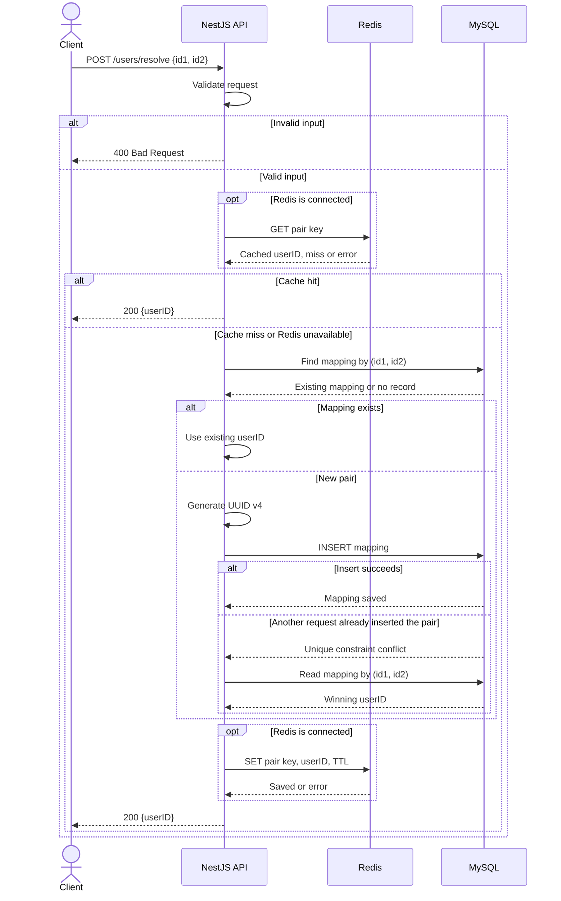

# Mediconcen Code Test

## Project overview

A NestJS API that maps a pair of IDs to a UUID v4 user ID. The first request
creates the mapping in MySQL; later requests with the same pair return the same
user ID. Redis caches lookups to reduce database reads.

Built with Node.js, TypeScript, NestJS, TypeORM, MySQL 8 and Redis.

## Prerequisites

For local development:

- Node.js 22 and npm 10 or later
- MySQL 8
- Redis 7 for caching and Redis integration tests

Docker with Compose is needed if you want to run the provided containers.
To run the entire application in Docker, a local Node.js installation is not needed.
The API can also run while Redis is unavailable, using MySQL directly.

## Installation

From the repository directory:

```sh
npm ci
cp .env.example .env
```

If running everything in Docker, skip `npm ci`. Edit `.env` before starting
services and replace the example passwords with your local passwords.

## Environment and configuration

The local application and migration commands load `.env` automatically.
The file is ignored by Git; do not commit credentials.

| Variable              | Purpose                                                               | Example / default        |
| --------------------- | --------------------------------------------------------------------- | ------------------------ |
| `PORT`                | Local application port; also the published app port in Compose        | `3000`                   |
| `DB_HOST`             | MySQL host when running Node.js locally                               | `127.0.0.1`              |
| `DB_PORT`             | Local MySQL connection port; also the published MySQL port in Compose | `3306`                   |
| `DB_NAME`             | Database name                                                         | `mediconcen`             |
| `DB_USER`             | Application database user                                             | `mediconcen`             |
| `DB_PASSWORD`         | Application database password                                         | Set in `.env`            |
| `MYSQL_ROOT_PASSWORD` | Root password used to initialize the Compose MySQL service            | Set in `.env`            |
| `REDIS_URL`           | Redis connection URL when running Node.js locally                     | `redis://127.0.0.1:6379` |
| `REDIS_TTL_SECONDS`   | Cache lifetime in seconds; must be a positive integer                 | `3600`                   |
| `REDIS_PORT`          | Published port for the Compose Redis service                          | `6379`                   |
| `APP_DB_HOST`         | MySQL host for the containerized application                          | `mysql`                  |
| `APP_REDIS_URL`       | Redis URL for the containerized application                           | `redis://redis:6379`     |

Inside Compose, the application uses port 3000 and connects to MySQL on port 3306. Changing the published ports does not change those internal ports.
If you change `REDIS_PORT` and run Node.js locally, update `REDIS_URL` to match.

## Database setup

To start the project's MySQL service:

```sh
docker compose up -d --wait mysql
npm run migration:run
```

Compose creates the database and application user from `.env`. If you already
have MySQL running, skip the Compose command, create the database and user if
needed, and set the `DB_*` variables to match. The user needs permission to run
migrations and read/write records in that database.

The migration creates `user_mappings`:

| Column       | Type           | Purpose              |
| ------------ | -------------- | -------------------- |
| `user_id`    | `CHAR(36)`     | UUID v4, primary key |
| `id1`        | `VARCHAR(128)` | First input ID       |
| `id2`        | `VARCHAR(128)` | Second input ID      |
| `created_at` | `DATETIME(6)`  | Creation timestamp   |

A unique constraint on `(id1, id2)` prevents duplicate mappings.
Automatic schema synchronization is disabled. To undo the last migration locally:

```sh
npm run migration:revert
```

MySQL data is stored in a named volume when using Compose. Stopping or removing
containers with `docker compose down` keeps that data. Changing passwords in
`.env` does not change credentials in an already initialized database.

## Starting the application

### Local development

After setting up MySQL and running migrations, start Redis if needed, then the app:

```sh
docker compose up -d --wait redis
npm run start:dev
```

If Redis is already running, skip the Compose command and use its URL in
`REDIS_URL`. The application listens at `http://localhost:3000` by default.

To run the compiled application locally:

```sh
npm run build
npm run migration:run:prod
npm run start:prod
```

### Docker

To start the app, MySQL and Redis together:

```sh
docker compose up --build -d --wait
```

The app runs migrations before starting. It uses a non-root user, and the image
does not include local `.env` files or development tools.

If another service is using the host ports, change `PORT`, `DB_PORT` or
`REDIS_PORT` in `.env` before starting this separate stack.

To run only the app container against an existing MySQL on your Mac and the
project's running Redis container:

```sh
APP_DB_HOST=host.docker.internal docker compose up --build -d --no-deps --wait app
```

This assumes MySQL is reachable on port 3306 and the configured database user
accepts connections from Docker. Start the project's Redis service first, or set
`APP_REDIS_URL` to another Redis URL reachable from the container.

```sh
docker compose logs app
docker compose down
```

## API endpoint and example request

`POST /users/resolve`

Both `id1` and `id2` are required strings of 1–128 characters. Empty strings,
leading/trailing whitespace and unknown fields are rejected.

```sh
curl -X POST http://localhost:3000/users/resolve \
  -H 'Content-Type: application/json' \
  -d '{"id1":"ABC123","id2":"XYZ456"}'
```

Example response:

```json
{
  "userID": "550e8400-e29b-41d4-a716-446655440000"
}
```

| Status | Meaning                                                                     |
| ------ | --------------------------------------------------------------------------- |
| `200`  | Returns the new or existing user ID                                         |
| `400`  | Invalid request body                                                        |
| `500`  | Unexpected application or database error; internal details are not returned |

Repeated requests with the same pair return the same `userID`.

## Sequence diagram



Each cache operation waits at most 200 ms. Cache failures do not prevent a
successful MySQL result from being returned. Unexpected database errors return
500 instead of continuing to cache or return a result.

## Running tests

```sh
npm test
npm run test:e2e
npm run test:redis
```

- Unit tests cover configuration, lookup logic and cache behavior. No services are needed.
- HTTP/MySQL tests require the configured MySQL database with migrations applied.
  They cover persistence, validation, errors and 20 concurrent requests for one pair.
  Redis can be available or unavailable.
- Redis integration tests require both MySQL and Redis. They cover cache hits,
  expiry, slow commands and a disconnected cache.

Integration tests use random ID prefixes and clean up their records. The Redis
tests temporarily pause the configured Redis server to simulate slow responses;
use a local or dedicated test instance.

Other checks:

```sh
npm run build
npm run lint
npm run format:check
```

## Assumptions and technical decisions

- Pairs are ordered: `(A, B)` and `(B, A)` are different. IDs are case-sensitive
  and are stored without trimming or normalization.
- The 128-character limit is an application choice. Inputs with surrounding
  whitespace are rejected rather than silently changed.
- MySQL is the permanent source of data. On a concurrent insert conflict, the
  application reads the mapping saved by the other request and returns its ID.
- Redis is a cache, not permanent storage. Successful database results are
  cached for one hour by default. Keys encode the pair as a JSON array so IDs
  containing delimiters do not collide.
- Redis connects and reconnects in the background. Disconnected clients skip
  the cache; each cache read/write waits at most 200 ms before falling back.
  A failed cache write does not fail a successful database operation.
- There are no update/delete endpoints. If mappings are changed or the database
  is reset manually, remove the corresponding Redis entries to avoid stale IDs.
